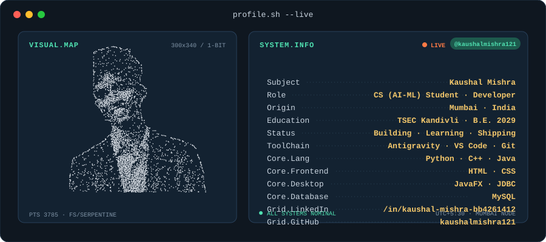

  

<h1 align="center">Hi, I'm Kaushal Mishra 👋</h1>

  Computer Science (AI-ML) student from Mumbai, building things with code and learning something new every day.

  
  

---

## 🧑‍💻 About Me

- 🎓 B.E. Computer Science (AI-ML) at **Thakur Shyamnarayan Engineering College**, Kandivli, Mumbai (2025 – 2029)
- 🤖 Interested in AI/ML, software development and building real projects
- 🌱 Currently sharpening my skills in Java, Python and databases
- 💼 Open to internships and entry-level opportunities in Mumbai (on-site, hybrid or remote)
- 💬 Ask me about: Java, Python, Git/GitHub, AI tools

---

## 🛠️ Tech Stack

  

---

## 🚀 Featured Project

### 💰 Payroll Management System
A desktop application to manage employee payroll with a login system and database storage.

- **Tech:** Java, JavaFX (FXML GUI), JDBC, MySQL
- **Highlights:** Employee records, salary handling, database-backed login
- 🔗 [View my repositories](https://github.com/kaushalmishra121/PAYROLL-MANAGEMENT-SYSTEMS)

---

## 📜 Certifications

- be10x — AI Tools & Claude Workshop

---

## 📊 GitHub Stats

  
  

---

## 📫 Let's Connect

- LinkedIn: [Kaushal Mishra](https://linkedin.com/in/kaushal-mishra-bb4261412)
- Email: kaushalamishra3@gmail.com

⭐ Thanks for stopping by!

